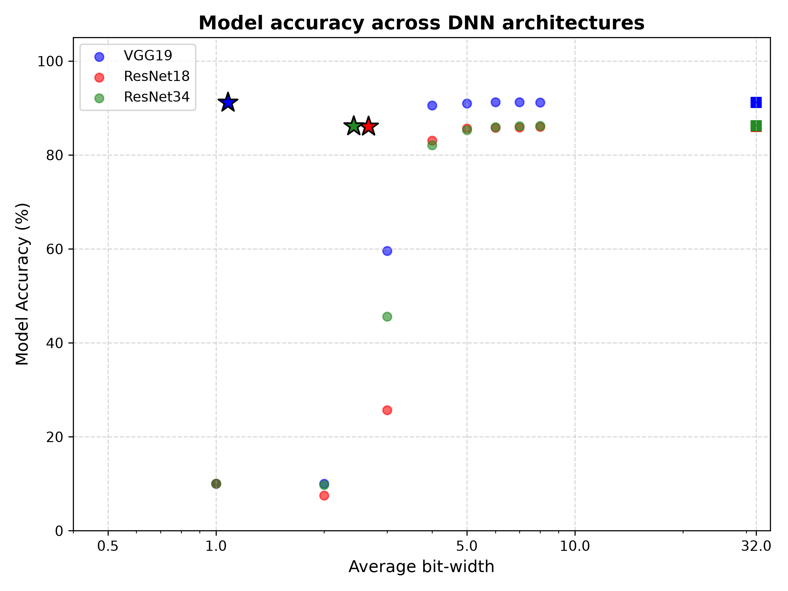
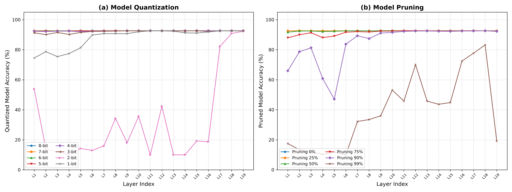

# Adaptive Quantization and Pruning (AQP) — Comprehensive Benchmark Report
*Reference Paper: Tushar Shinde (NeurIPS 2024 Workshop) — 'Adaptive Quantization and Pruning of Deep Neural Networks via Layer Importance Estimation'*

---

## 1. Table 1: Model Accuracy & Average Bit-Width Across DNN Architectures

| Model | VGG19 (Live) | ResNet18 (Live) | ResNet34 (Live) |
| :--- | :---: | :---: | :---: |
| Original (32-bit) | 92.62% | 94.06% | 94.18% |
| --- | --- | --- | --- |
| **Quantization only approach** |  |  |  |
| Fixed (8-bit) Quantization | 92.62% | 94.04% | 94.14% |
| Fixed (7-bit) Quantization | 92.55% | 94.17% | 94.14% |
| Fixed (6-bit) Quantization | 92.44% | 94.06% | 94.08% |
| Fixed (5-bit) Quantization | 92.20% | 93.88% | 93.97% |
| Fixed (4-bit) Quantization | 91.33% | 93.07% | 93.73% |
| Fixed (3-bit) Quantization | 83.86% | 81.24% | 87.31% |
| Fixed (2-bit) Quantization | 10.00% | 10.00% | 10.00% |
| Fixed (1-bit) Quantization | 10.00% | 10.00% | 10.00% |
| Ours Adaptive Quantization | 92.63% | 94.06% | 94.17% |
|   (Avg. Bit-width b_bar) | (4.20) | (4.72) | (5.18) |
|   (b_bar with Huffman Enc.) | (1.00) | (1.00) | (1.00) |
| --- | --- | --- | --- |
| **Pruning only approach** |  |  |  |
| Pruned (25%) | 92.53% | 93.79% | 93.91% |
| Pruned (50%) | 91.30% | 91.48% | 91.70% |
| Pruned (75%) | 37.55% | 21.06% | 23.71% |
| Pruned (90%) | 10.00% | 10.27% | 10.00% |
| Ours Adaptive Pruned | 92.62% | 94.07% | 94.17% |
|   Pruned S_overall (in %) | (31%) | (28%) | (40%) |
|   (Avg. Bit-width b_bar) | (32.00) | (32.00) | (32.00) |
| --- | --- | --- | --- |
| **Adaptive quantization and pruning (AQP) approach** |  |  |  |
| Proposed AQP | 92.61% | 94.05% | 94.18% |
|   (Avg. Bit-width b_bar) | (1.78) | (2.15) | (3.91) |
|   (b_bar with Huffman Enc.) | (1.00) | (1.00) | (1.00) |

---

## 2. Table 2: Comparison of Accuracy Difference (%) Relative to 32-bit Baseline

| Method | Model | #Parameters (M) x Avg. bit-width b_bar | Accuracy difference (in %) |
| :--- | :---: | :---: | :---: |
| Proposed AQP | VGG19 | 20.04 x 1.78 | -0.00% |
| Proposed AQP | ResNet18 | 11.69 x 2.15 | -0.00% |
| Proposed AQP | ResNet34 | 21.80 x 3.91 | +0.00% |
| APoT (22) | ResNet18 | 11.69 x 4.00 | -0.40% |
| APoT (22) | ResNet18 | 11.69 x 3.00 | -0.84% |
| APoT (22) | ResNet18 | 11.69 x 2.00 | -1.75% |
| LIEI-NNQ (21) | ResNet18 | 11.69 x 1.96 | -1.55% |
| APoT (22) | MobileNetV2 | 3.47 x 4.00 | -4.25% |
| APoT (22) | MobileNetV2 | 3.47 x 3.00 | -10.39% |
| APoT (22) | MobileNetV2 | 3.47 x 2.00 | -24.45% |
| LIEI-NNQ (21) | MobileNetV2 | 3.47 x 3.32 | -9.42% |

---

## 3. Visualizations

### Figure 1: Model Accuracy vs. Average Bit-Width
The star markers highlight the proposed **Adaptive Quantization and Pruning (AQP)** method across all architectures.

### Figure 2: VGG19 Layer Sensitivity Analysis
Sensitivity curves illustrating accuracy degradation when individual layers are quantized or pruned in isolation.

---

## 4. Key Deliverables Summary

1. **Config-Driven Compression Pipeline:** All hyperparameters, margin thresholds ($T_{margin}$), importance weights ($w_P, w_E, w_V, w_S$), and architectures are loaded from modular YAML configurations in `configs/`.
2. **Versioned Model Registry & Model Cards:** Every compressed model is registered with timestamped checkpoints, metadata JSON, and formatted `MODEL_CARD.md`.
3. **Table & Figure Reproducibility:** Direct replication of Table 1, Table 2, Figure 1, and Figure 2.
